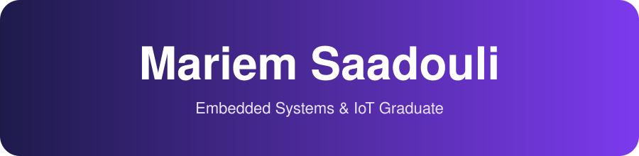

  

  +embedded+systems+%26+iot+graduate.;>+building+connected+devices.&font=Fira+Code&size=20&color=A78BFA&background=0D1117&center=true&vCenter=true&width=700&height=50&pause=1000" />

### About

I graduated in Embedded Systems and IoT from ISI Mahdia. I enjoy working with microcontrollers, sensors and connected devices, building projects that bring hardware and software together.

### Tech Stack

### Contact

Open to internships, collaborations and embedded/IoT projects. Feel free to reach out.

