<p align="center">
  
</p>

<p align="center">
  
</p>

<p align="center">
  <a href="mailto:mariem.saadouli@ieee.org"></a>
  <a href="https://github.com/mariemsaadouli"></a>
</p>

---

### 👩‍💻 About me

I graduated in **Embedded Systems and IoT** from **ISI Mahdia**. I enjoy working with microcontrollers, sensors and connected devices, building projects that bring hardware and software together.

```c
// mariem.h
const char *focus[]   = { "Embedded firmware", "Sensor integration", "IoT devices" };
const char *platforms[] = { "STM32", "ESP32", "Arduino", "Raspberry Pi" };
const char *school    = "ISI Mahdia: Embedded Systems & IoT";
```

### 🛠️ Tech stack

<table>
  <tr>
    <td align="right"><b>Languages</b></td>
    <td>
      
      
      
    </td>
  </tr>
  <tr>
    <td align="right"><b>Hardware</b></td>
    <td>
      
      
      
      
    </td>
  </tr>
  <tr>
    <td align="right"><b>Tools</b></td>
    <td>
      
    </td>
  </tr>
</table>

<!--
### 🔌 Featured projects

Uncomment this section and fill in your real projects (2–4 is ideal).

| Project | What it does | Built with |
|---|---|---|
| [**project-name**](https://github.com/mariemsaadouli/project-name) | One-line problem → solution | `STM32` `C` |
| [**project-name**](https://github.com/mariemsaadouli/project-name) | One-line problem → solution | `ESP32` `MQTT` |
-->

### 📈 Contribution activity

<p align="center">
  
</p>

<p align="center">
  
</p>
