  <picture>
    <source media="(prefers-color-scheme: light)" srcset="assets/hero-light.svg" />
    
  </picture>

  
  

  <picture>
    <source media="(prefers-color-scheme: light)" srcset="assets/about-light.svg" />
    
  </picture>

  <picture>
    <source media="(prefers-color-scheme: light)" srcset="assets/projects-header-light.svg" />
    
  </picture>

<!-- Add project cards here later, e.g.

-->

  <picture>
    <source media="(prefers-color-scheme: light)" srcset="assets/toolkit-light.svg" />
    
  </picture>

  <picture>
    <source media="(prefers-color-scheme: light)" srcset="assets/heatmap-light.svg" />
    
  </picture>

  <picture>
    <source media="(prefers-color-scheme: light)" srcset="assets/footer-light.svg" />
    
  </picture>

